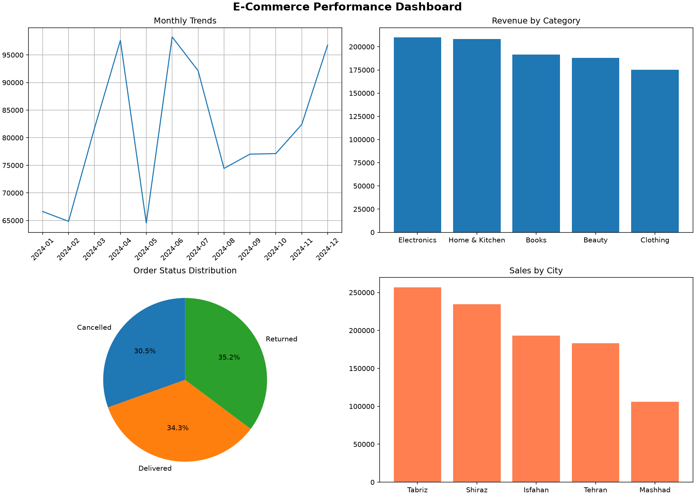

# 📊 E-Commerce Customer & Sales Intelligence Dashboard

An end-to-end data analysis and visualization pipeline built with **Python**, **Pandas**, and **Matplotlib**. This project simulates a relational e-commerce dataset, processes and merges relational schemas, performs multidimensional business analytics, and renders an executive performance dashboard.

---

## 🚀 Key Features

- **Synthetic Relational Data Engine (`generate_data.py`):**
  - Generates realistic datasets simulating customers, orders, and individual order line items with foreign key relationships.
- **Relational Data Merging & Transformation:**
  - Multi-table merging (`customers` ⟕ `orders` ⟕ `order_items`) using primary/foreign key joins.
  - Feature engineering (Total Price calculation, Datetime parsing, and Monthly Period grouping).
- **Core Business Analytics:**
  - Revenue breakdown by product category and fulfillment status.
  - Customer segmentation (Premium vs. Standard).
  - Geographical distribution of sales across cities.
  - Monthly longitudinal trend analysis.
- **Visual Analytics Dashboard:**
  - 4-quadrant interactive visualization saved automatically as high-resolution PNG (`dashboard.png`).

---

## 📈 Dashboard Preview



---

## 🛠️ Project Structure
```text
Ecommerce-Sales-Intelligence/
│
├── customers.csv             # Customer profile data (ID, Name, City, Tier)
├── orders.csv                # Order-level metadata (ID, Customer ID, Date, Status)
├── order_items.csv           # Itemized transaction records (Item ID, Order ID, Price, Qty)
├── generate_data.py          # Synthetic relational data generator
├── ecommerce_analytics.py    # ETL pipeline, aggregation & plotting engine
├── dashboard.png             # Exported high-res dashboard visualization
└── README.md                 # Project documentation
```
---

## ⚙️ How to Run
Clone the repository:
```bash
   git clone https://github.com/ItzMeysam/Ecommerce-Sales-Intelligence.git
   cd Ecommerce-Sales-Intelligence
```
Install required dependencies:
```bash
   pip install pandas matplotlib
```
   Generate synthetic data:
```bash
   python generate_data.py
```
Run the analytics and dashboard pipeline:
```bash
   python ecommerce_analytics.py
```
## 💡 Tech Stack
- Language: Python 3.10+
- Data Manipulation: Pandas
- Data Visualization: Matplotlib